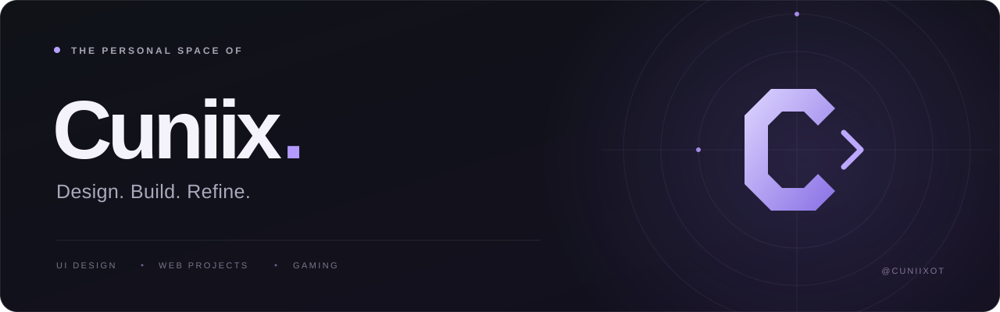

  

  <strong>Clean interfaces. Creative ideas. Attention to detail.</strong>
   
  Exploring the space between design, development and gaming.

  <a href="https://github.com/CuniixOT?tab=repositories">Explore my repositories</a>
  &nbsp; · &nbsp;
  <a href="https://github.com/CuniixOT?tab=stars">Things I find interesting</a>

 

### A little about me

Hey, I'm **Cuniix**. I'm into thoughtful UI, personal web projects and gaming communities. I like turning ideas into something that feels good to use — and refining the little details along the way.

 

### What catches my interest

| Design | Development | Gaming |
| :--- | :--- | :--- |
| Clean layouts and visual identities | Websites and community tools | FiveM and Minecraft projects |
| Small details that make a difference | Bringing ideas to life | Custom experiences for players |

 

---

  Keep it simple. Make it feel right.

